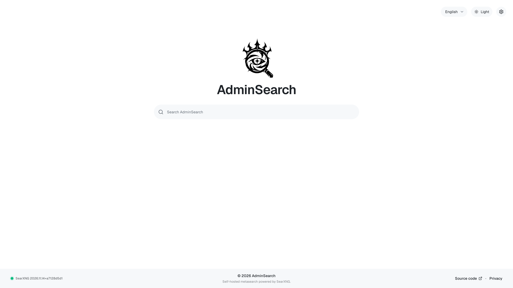
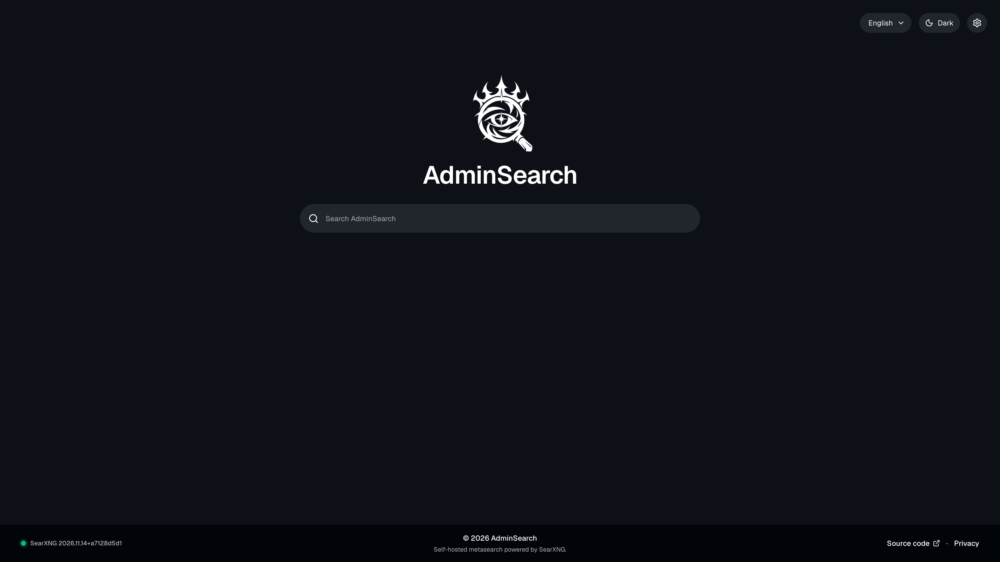

<p align="center">
  
</p>

<p align="center">
  
  
  
  
  
</p>

<p align="center">
  <b>Search like you own the place.</b><br>
  <sub>A self-hosted search frontend built with Next.js and backed by your own private SearXNG instance. No accounts, no tracking, no analytics.</sub>
</p>

<p align="center">
  <a href="#quick-start">Quick start</a> &nbsp;·&nbsp;
  <a href="#inside">Inside</a> &nbsp;·&nbsp;
  <a href="#configuration">Configuration</a> &nbsp;·&nbsp;
  <a href="#self-hosting">Self-hosting</a> &nbsp;·&nbsp;
  <a href="#railway">Railway</a> &nbsp;·&nbsp;
  <a href="THEMES.md">Themes</a>
</p>

<br>

<p align="center">
  &thinsp;
</p>

<br>

## Quick start

```bash
git clone https://github.com/AdminGodZ/AdminSearch.git && cd AdminSearch
cp .env.example .env
# set NEXT_PUBLIC_APP_URL, and SEARXNG_SECRET to the output of: openssl rand -hex 32
docker compose up -d --build
```

That starts AdminSearch, SearXNG, Valkey and Caddy. Open the URL you set in
`NEXT_PUBLIC_APP_URL`.

> [!TIP]
> Caddy binds to `127.0.0.1:80` by default. Set `PUBLIC_BIND_ADDRESS=0.0.0.0`
> only when the port should be reachable from outside the server.

## Inside

<table>
  <tr>
    <th align="left" width="33%">Search</th>
    <th align="left" width="33%">Privacy</th>
    <th align="left" width="33%">Interface</th>
  </tr>
  <tr valign="top">
    <td>Web, image, video and news results with configurable engines, language and result behavior, served from your own SearXNG instance.</td>
    <td>Every query is proxied server-side. No user accounts, tracking profiles or client-side analytics, plus an optional outgoing proxy pool for SearXNG.</td>
    <td>English and German localization. Light, dark and system appearance with <a href="THEMES.md">named color themes</a>.</td>
  </tr>
  <tr>
    <th align="left">Self-hosting</th>
    <th align="left">Rate limiting</th>
    <th align="left">Platforms</th>
  </tr>
  <tr valign="top">
    <td>One Docker Compose stack: AdminSearch, SearXNG, Valkey and Caddy.</td>
    <td>Redis/Valkey-backed limits for search and autocomplete, with shared pagination continuations.</td>
    <td>Separate Docker images for Railway and similar platforms.</td>
  </tr>
</table>

<p align="center">
  <sub>
    &nbsp;Next.js 16 &nbsp;·&nbsp;
    next-intl 4 &nbsp;·&nbsp;
    &nbsp;React 19 &nbsp;·&nbsp;
    &nbsp;TypeScript 7 &nbsp;·&nbsp;
    &nbsp;Tailwind CSS &nbsp;·&nbsp;
    &nbsp;shadcn/ui &nbsp;·&nbsp;
    &nbsp;SearXNG &nbsp;·&nbsp;
    &nbsp;Valkey &nbsp;·&nbsp;
    &nbsp;Caddy
  </sub>
</p>

## Local development

Requires Node.js 22 with npm, and Docker with Docker Compose.

```bash
npm install
cp .env.example .env              # set SEARXNG_SECRET (openssl rand -hex 32)
docker compose up -d searxng-core valkey
npm run dev                       # http://localhost:3000
```

<details>
<summary>Scripts</summary>
<br>

| Script              |                                |
| :------------------ | :----------------------------- |
| `npm run dev`       | Development server             |
| `npm run typecheck` | TypeScript check               |
| `npm run build`     | Typecheck and production build |
| `npm run start`     | Serve the production build     |
| `npm test`          | Node test suite                |
| `npm run lint`      | Biome checks                   |
| `npm run format`    | Biome formatting               |

</details>

## Configuration

| Variable                        | Default                          |                                                |
| :------------------------------ | :------------------------------- | :--------------------------------------------- |
| `NEXT_PUBLIC_APP_URL`           | `http://localhost:3000`          | Public URL, embedded at build time             |
| `SEARXNG_INTERNAL_URL`          | `http://127.0.0.1:8080`          | Private SearXNG endpoint                       |
| `SEARXNG_SECRET`                | —                                | Required. Generate with `openssl rand -hex 32` |
| `RATE_LIMIT_REDIS_URL`          | —                                | Redis/Valkey for rate limiting                 |
| `SEARCH_CONTINUATION_REDIS_URL` | —                                | Redis/Valkey for pagination continuations      |
| `SEARXNG_OUTGOING_PROXY_URLS`   | —                                | Optional outgoing proxy pool, one URL per line |
| `VALKEY_IMAGE`                  | `docker.io/valkey/valkey:latest` | Valkey image for Compose                       |

See [`.env.example`](.env.example) for every setting, including rate-limit
windows, continuation lifetimes, DNS and Caddy binding.

<details>
<summary>Outgoing proxy pool</summary>
<br>

`SEARXNG_OUTGOING_PROXY_URLS` takes a newline-separated list of trusted
`http://`, `https://`, `socks5://` or `socks5h://` proxy URLs. SearXNG
distributes requests across the pool and uses another proxy when retrying an
HTTP failure. Proxy credentials stay in runtime-only configuration and are
never written to source control or application logs.

> [!WARNING]
> The proxy operator can observe outbound search traffic. Use a provider you
> trust.

</details>

<details>
<summary>Pagination continuations</summary>
<br>

`SEARCH_CONTINUATION_REDIS_URL` stores opaque pagination continuations in a
shared Redis/Valkey instance. When it is empty, AdminSearch reuses
`RATE_LIMIT_REDIS_URL`; when neither is configured, a bounded process-local
store keeps single-instance development working.

</details>

The custom SearXNG image is built from `docker.io/searxng/searxng:latest`,
including whenever the Compose stack starts; the Railway Dockerfile uses the
same unpinned base image.

## Self-hosting

Set `NEXT_PUBLIC_APP_URL` and `SEARXNG_SECRET` in `.env`, then:

```bash
docker compose up -d --build
```

Update the service images with:

```bash
docker compose pull valkey caddy
docker compose build --pull searxng-core nextjs
docker compose up -d
```

## Railway

Create three services in one Railway project:

| Service        | Source                                 |
| :------------- | :------------------------------------- |
| `adminsearch`  | This repository, root `Dockerfile`     |
| `searxng-core` | This repository, `/searxng/Dockerfile` |
| Redis          | Railway's managed Redis                |

Configure `adminsearch`:

```text
NEXT_PUBLIC_APP_URL=https://<your-domain>
SEARXNG_INTERNAL_URL=http://searxng-core.railway.internal:8080
RATE_LIMIT_REDIS_URL=${{Redis.REDIS_URL}}
RATE_LIMIT_TRUST_PROXY_HEADERS=true
RATE_LIMIT_TRUSTED_PROXY_HOPS=1
```

> [!IMPORTANT]
> Set `NEXT_PUBLIC_APP_URL` before the image is built, because Next.js embeds
> it during the production build. Replace `Redis` in the reference if the
> managed service has a different name.

Configure `searxng-core`:

```text
SEARXNG_SECRET=<generated-random-secret>
SEARXNG_PORT=8080
SEARXNG_BIND_ADDRESS=::
SEARXNG_OUTGOING_PROXY_URLS=<optional-multiline-secret>
SEARXNG_OUTGOING_RETRIES=1
SEARXNG_OUTGOING_EXTRA_PROXY_TIMEOUT=10
```

Add one proxy URL per line to the Railway multiline variable and never commit
proxy credentials. If the variable is empty, SearXNG uses Railway's normal
outbound network.

Only generate a public domain for `adminsearch`. Keep `searxng-core` and Redis
private. Caddy is only used by the self-hosted Compose stack.

<details>
<summary>Static outbound IPs</summary>
<br>

On Railway Pro, enable Static Outbound IPs for `searxng-core` and redeploy.
Railway assigns multiple permanent IPv4 addresses and balances outbound
connections across them:

```bash
railway outbound-network static-ip enable --service searxng-core
railway redeploy --service searxng-core --yes
```

The pool is small and its addresses may be shared with other customers, so it
reduces dependence on one egress IP but cannot guarantee that search engines
won't present CAPTCHAs. Use the outgoing proxy pool when more egress diversity
is required.

</details>

## Privacy

Browser search requests go through AdminSearch to the configured private
SearXNG backend. AdminSearch does not require user accounts, tracking profiles,
or client-side analytics.

<br>

<p align="center">
  <picture>
    <source media="(prefers-color-scheme: dark)" srcset="assets/logo/adminsearch-mark-white.svg">
    
  </picture>
</p>
